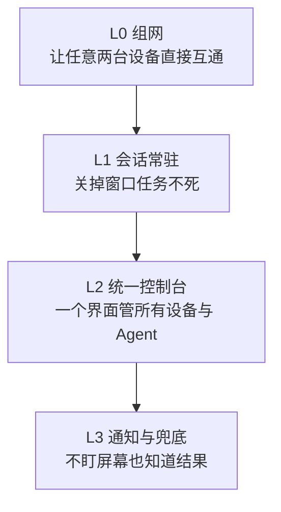

# 设备与 Agent 统一管理

## 一、项目目标

设备一多，操作就会散：机器 A 上有一个 Agent，机器 B 上有一个 Agent，机器 C 上的服务只能从机器 C 本机连上。人坐在 A 前面，想知道乙在跑什么、想重启 C 上的服务、想在任务结束时收到一条通知，就得逐台切换、逐台登录。

```text
机器 A 上有 Agent 甲，机器 B 上有 Agent 乙，机器 C 上的服务只有从机器 C 才连得上。
人在机器 A 上，想知道乙在跑什么；想重启 C 上的服务；想收一个「任务完成了」的通知。
```

这一页给出的做法是四层各挑一个组件拼起来：**组网**（设备之间互相可达）+ **会话常驻**（关掉窗口任务不死）+ **统一控制台**（一个界面看所有设备与 Agent）+ **通知**（不盯屏幕也知道结果）。解决的是同一个问题：把「人现在在哪」和「要操作哪台机器」解耦。

| 层次 | 目标 | 验收方式 |
| --- | --- | --- |
| 基础 | 任意两台设备之间可直接互通，不依赖第三方中转 | 两台设备互 ping 延迟在个位毫秒级 |
| 基础 | 没有客户端的设备（打印机一类）也能被访问 | 从另一台设备能打开它的管理页面 |
| 会话 | 关掉终端窗口后，里面的任务继续跑；换台设备能重新接管 | 断开后重连，任务仍在，还能看到期间的新输出 |
| 统一 | 一个界面能看到所有设备与上面的 Agent，不用逐台 SSH | 打开控制台能看到设备列表与状态 |
| 通知 | 任务结束时能收到通知，通知渠道只有一个 | 只留一个渠道，仍能收到 |
| 可交接 | 设备与 Agent 的清单是一份可读的文件，新人照着能理解全貌 | 新人读完清单能说出每台机器上有什么 |

**不做的事**：跨实验室的联邦组网；把内网服务暴露到公网。

## 二、环境

### 2.1 需要什么

| 需要 | 说明 |
| --- | --- |
| 至少两台设备 | 一台始终在线，一台可移动。只有一台设备验证不了任何东西 |
| 每台设备的管理员权限 | 装客户端、改路由都要 |
| 一个组网账号 | 免费额度够个人与小团队规模使用 |
| 一个可用的内网网段 | 只有要覆盖装不了客户端的设备时才需要 |
| 统一的设备命名 | 先定好名字再接入，改名比接入麻烦 |
| 前置知识 | 知道 IP、端口、子网是什么意思；不了解就先看[学习](../学习/README.md) |

容易卡住的两处：设备名没定好就开始接入；只有一台设备就想验证「任意两台互通」。

### 2.2 设备角色

做法不绑定具体型号，按角色准备设备：

| 角色 | 特征 | 在方案里承担的作用 |
| --- | --- | --- |
| 常驻主机 | 一直在线的 Windows 主机 | 日常操作面、控制台、部分 Agent |
| 移动笔记本 | 会换网络、会关机 | 随身接入，要求到哪里都能连回来 |
| GPU 服务器 | Linux，有显卡 | 跑重任务 |
| 通用服务器 | Linux，长期在线 | 跑自托管服务 |
| 移动设备 | 手机、平板 | 装客户端当终端用，也可以作为被管理对象 |
| 无客户端设备 | 打印机一类装不了客户端的设备 | 只能靠子网路由访问，见 3.3 |
| 边缘设备 | 算力有限的小设备 | 跑轻量 Agent 与采集 |

无客户端设备是很多方案的盲区：能装客户端的设备都好办，装不了的那些必须靠「把整个网段通告出去」解决。

### 2.3 用到的工具

| 层 | 工具 | 装在哪 |
| --- | --- | --- |
| L0 组网 | Tailscale | 每台设备 |
| L1 会话常驻 | herdr | 每台要跑 Agent 的机器 |
| L2 统一控制台 | Agents Anywhere，自托管 | 一台常驻服务器 |
| L3 通知 | 一个 IM 机器人 + 一个自建推送服务 | 服务器与手机 |

选型理由与放弃过的方案见第六节。

### 2.4 设备清单

设备一多，靠记忆管不住。做法是维护一份清单文件（例如 `fleet.yaml`），记录设备、上面的 Agent、暴露的服务与约定；清单进版本控制，凭据不进。

```yaml
version: 1
session_manager: herdr
tailnet: <组网标识>

network:
  provider: tailscale
  server_subnet_router:
    advertise_routes: [<内网网段>]     # 由哪台机器通告
  rules: [...]

devices:
  <设备名>:
    display_name: <显示名>
    os: <系统>
    location: <位置，泛化为「实验室/机房」>
    addresses: { lan: <内网IP>, tailscale: <组网IP> }
    agents:
      - id: <Agent 标识>
        kind: <类型>
        launch: <启动命令>
        session: agent-<设备名>-<用途>
    runtime: { docker: <有/无>, node: <有/无> }
    known_issues: [...]

exposed_web_uis:
  - device: <设备名>
    name: <服务名>
    url: <组网内地址>
    auth: <认证方式>

invariants:      # 不变量：违反这些的改动一律不合并
  - Agent 必须跑在 herdr 会话里
  - 面向组网的服务只绑组网地址，不绑 0.0.0.0
  - IM 机器人只保留一个
  - 每台设备独立 SSH 密钥
  - 设备或 Agent 有变动，先改本文件
```

把不变量放进清单，是因为写在另一份文档里的约定不会被遵守：改设备时一定会打开的是这份清单。

命名约定：会话 `agent-<设备名>-<用途>`；Agent 标识 `<角色>-<编号>`；设备名用统一前缀加角色，不用人名（人会更替，设备还在）。命名整齐的价值在控制台里体现——看到一堆会话时能立刻知道哪个是干什么的。

## 三、复现步骤

这一节按**分阶段最小可验证**组织：每一步都能独立跑通并判定成功，再进下一步。命令里的主机名、地址、网段一律用占位符。

### 3.1 创建网络

1. 在组网服务上建一个网络，拿到网络标识。
2. 每台设备装客户端，按系统选一种：

   ```powershell
   # Windows（winget 官方包）
   winget install --id Tailscale.Tailscale -e --accept-package-agreements --accept-source-agreements
   ```

   ```bash
   # Linux（官方安装脚本）
   curl -fsSL https://tailscale.com/install.sh | sh
   ```

   ```bash
   # Arch / WSL
   sudo pacman -S --needed tailscale
   ```

   Windows 上客户端不在 PATH 里，要么用全路径调用，要么自己加进 PATH。这是第一次用最容易迷惑的一点。

3. 第一台设备上线，确认它出现在网络里：

   ```bash
   sudo tailscale up --hostname=<设备名> --ssh
   tailscale status
   ```

### 3.2 给网络添加设备

接入第二台设备之后，才能验证「任意两台互通」。

```bash
# Windows
& "C:\Program Files\Tailscale\tailscale.exe" up --hostname=<设备名>
# Linux 服务器（同时作为子网路由器）
sudo tailscale up --hostname=<设备名> --ssh --advertise-routes=<内网网段>
# WSL
tailscale up --hostname=<设备名> --accept-routes --accept-dns=false
```

接入时就用最终名字，不要留着默认主机名。加完用 `tailscale status` 确认列表里有它，再用 `tailscale ping` 看延迟：

```bash
tailscale ping <设备名>
```

延迟是个位毫秒，说明打洞成功。延迟从个位跳到一百毫秒以上，说明链路掉到中转了，先看是不是有别的 VPN 客户端抢了路由。

### 3.3 覆盖装不了客户端的设备

打印机一类设备装不了客户端，要把它所在的网段通告出去。以下三件事必须同时成立，**缺一件就静默不生效、不报错**：

| 在哪做 | 做什么 |
| --- | --- |
| 网段所在的服务器 | 打开 IP 转发 |
| 组网控制面 | 批准这条路由通告 |
| 每台要访问该网段的客户端 | 启动时加 `--accept-routes` |

```bash
# 服务器端：开转发并持久化
printf 'net.ipv4.ip_forward=1\nnet.ipv6.conf.all.forwarding=1\n' | sudo tee /etc/sysctl.d/99-tailscale.conf
sudo sysctl -p /etc/sysctl.d/99-tailscale.conf
```

只通告不批准，或者客户端没加 `--accept-routes`，都不会报错，只是不通。更完整的说明见 [Tailscale 组网](../参考/Tailscale组网.md)。

### 3.4 让任务不随窗口结束

每台要跑 Agent 的机器装会话管理器：

```bash
herdr                     # 启动或接入本机后台会话
herdr --remote <主机>     # 跨机接管
```

Agent 一律在这个会话里启动，会话名按 2.4 的约定写。判断标准很简单：关掉所有终端窗口，第二天回来任务还在。

### 3.5 一个界面看所有设备与 Agent

按项目官方文档用 Docker 自托管一套控制台，不要用公共托管服务。装好后把各设备接进去，控制台里应该能看到设备列表与各设备上的 Agent。

### 3.6 通知只留一个渠道

配一个 IM 机器人加一个自建推送服务。**渠道只留一个**：先接三个渠道的结果通常是没有任何人看。

### 3.7 验收判据

按阶段验收，不要看「装完了没」，看这几条：

```text
① 两台设备互 ping，延迟是个位毫秒          → L0 打成
② 断网重连（关 WiFi 再开），设备自动回来    → L0 稳定
③ 从一台设备访问到无客户端设备的管理页       → 子网路由三件套齐了
④ 关掉所有终端窗口，第二天回来看任务还在     → L1 打成
⑤ 在控制台里看到全部设备，不用逐台 SSH      → L2 打成
⑥ 手机只留一个通知渠道，仍能收到任务结束通知 → L3 打成
⑦ 把清单文件给一个没参与的人读，
   他能说出每台机器上有什么                  → 可交接
```

第 ⑦ 条是这套做法真正的完成标准：前面六条说明「能跑」，第七条说明「别人能接手」。

## 四、成果

做完之后得到的是五样东西：

| 成果 | 形态 |
| --- | --- |
| 一张随时可达的设备网 | 任意两台设备直连互通，装不了客户端的设备也能访问 |
| 一批不会随窗口消失的任务 | Agent 跑在会话里，换台设备可以接管 |
| 一个统一入口 | 控制台里能看到所有设备与 Agent，不用逐台 SSH |
| 一条通知渠道 | 任务结束能收到通知，不需要盯着屏幕 |
| 一份可交接的清单 | 新人读完能说出每台机器上有什么 |

前四样决定这套做法能不能用，第五样决定换人之后它还在不在。

## 五、已知问题

| 问题 | 表现 | 去哪看 |
| --- | --- | --- |
| 子网路由静默不通 | 已通告已批准，仍然连不上 | 3.3 的三件套 |
| 延迟突然变高 | 从个位毫秒跳到一百毫秒以上 | [Tailscale 组网](../参考/Tailscale组网.md) |
| 服务端口冲突 | 症状出现在完全无关的服务上 | [端口占用导致同域名本机访问 404](../经验/端口占用导致同域名本机访问404.md) |
| 连接器报记录被占用 | `The local Connector record is busy`，重试无效 | [Agent 平台部署](../参考/Agent平台部署.md) |
| 组网客户端与其它 VPN 抢路由 | 打洞失败，流量走中转 | [Tailscale 组网](../参考/Tailscale组网.md) |

## 六、用到的技术

### 6.1 四层结构



四层的顺序不能换：没有 L0，上面每一层都要自己造一套连接方式；没有 L1，L2 里的会话一断就没了。

### 6.2 每层选什么，为什么

| 层 | 选择 | 理由 | 放弃的方案与原因 |
| --- | --- | --- | --- |
| L0 组网 | **Tailscale** | 几乎零配置就能打洞直连，控制面免费；Windows、Linux、手机都有客户端 | 自建 Headscale：控制面自主，但要多维护一套服务，现阶段收益不明显，保留为后续可平滑迁移的方向；纯手工 WireGuard：节点一多，配置就是手工活 |
| L1 会话常驻 | **herdr** | 跨平台，能 `--remote` 接管别的机器上的会话 | 传统终端复用器：能用，但跨机接管体验差 |
| L2 统一控制台 | **Agents Anywhere，自托管** | 开源、可自己部署，覆盖面比只管一种 Agent 的方案广 | 只管某一种 Agent 的工具：覆盖不到实际在用的全部 Agent；SaaS 控制台：要把设备信息交出去 |
| L3 通知 | **一个 IM 机器人 + 一个自建推送服务** | 推送服务自建不受第三方限制；机器人只留一个，通知不会散在几个地方 | 多个机器人并行：结果是没人知道该看哪个 |

### 6.3 一条贯穿全程的原则

**连接一律由内向外发起。**

设备上的连接器主动连出去到控制台，控制台不需要能连上设备。这样：

- 不需要在内网开任何入站端口。
- 设备在 NAT 后面、换网络、换 IP 都不影响。
- 想停掉某台设备的接入，在控制台上断开即可。

这条原则是选型时最有分量的一条：遵守它就不需要靠配置去限制「谁能进来」。

## 相关

- [Tailscale 组网](../参考/Tailscale组网.md) —— L0 的完整用法
- [Agent 平台部署](../参考/Agent平台部署.md) —— L1 与 L2 的完整用法
- [监控与备份](../参考/监控与备份.md) —— 设备接入之后怎么知道它还好
- [端口占用导致同域名本机访问 404](../经验/端口占用导致同域名本机访问404.md) —— 端口登记的由来
